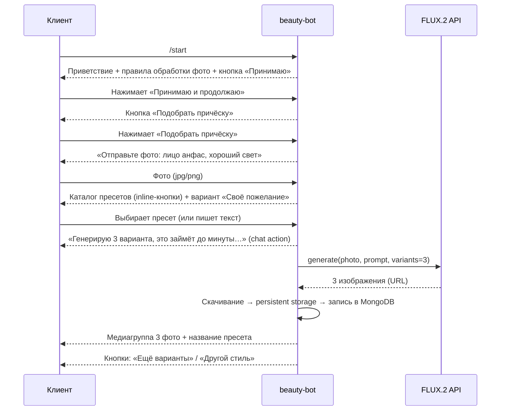
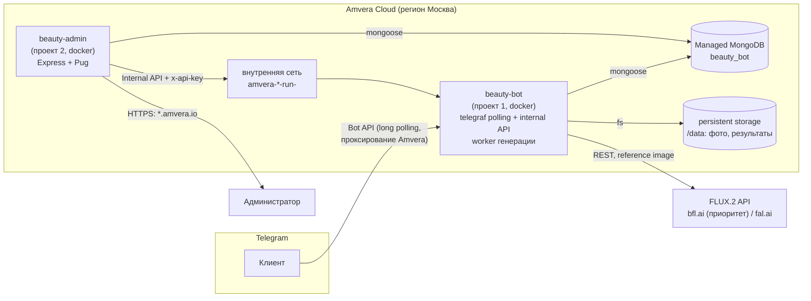

# Техническое задание. Beauty Bot Service

| | |
|---|---|
| **Документ** | ТЗ v1.0 (черновик на согласовании) |
| **Дата** | 2026-10-04 |
| **Проект** | Beauty Bot Service — телеграм-бот подбора причёсок для салона красоты |
| **Репозиторий** | `store/beauty_bot_service` (единственное место записи по этому проекту) |
| **Роли** | Заказчик — салон красоты; Разработка — Виталий + ИИ-агент |

---

## 1. Цель и назначение

Создать телеграм-бота, который по селфи клиента и текстовым пожеланиям генерирует
**1–3 варианта новой причёски с сохранением лица** и возвращает их в чат. Сервис помогает
клиенту решиться на смену образа до визита в салон и повышает конверсию консультации мастера.

Область применения: один салон (v1), использование клиентами **самостоятельно**, без участия персонала.

### 1.1 Результаты проекта

1. Docker-контейнер **beauty-bot** (инстанс бота) — деплой на Amvera Cloud.
2. Docker-контейнер **beauty-admin** (админка) — деплой на Amvera Cloud, доступна по HTTPS-домену.
3. Managed MongoDB (Amvera) — общая БД сервиса.
4. Интеграция с API генерации изображений **FLUX.2** (bfl.ai — приоритет, fal.ai — альтернатива).
5. Настоящее ТЗ, план работ и приёмочные критерии.

### 1.2 Решения, принятые до написания ТЗ (от заказчика)

| # | Решение |
|---|---------|
| Р1 | Модель генерации — семейство **FLUX.2** (Black Forest Labs). |
| Р2 | Хостинг — **Amvera Cloud** (рубли, git-деплой, docker). |
| Р3 | Пользователи бота v1 — **клиенты салона** (не мастера). |
| Р4 | Провайдер API — **bfl.ai / fal.ai**, оплата зарубежной картой/криптой (не РФ-агрегатор). |
| Р5 | Масштаб v1 — **один салон**, без мульти-аренды. |
| Р6 | Админка v1 — **каркас + статистика** (детальная функциональность — позже). |
| Р7 | Образец кода инстанса — `repos-projects/tgbot/tg-support-bot-instance`; образец админки — `repos-projects/tgbot/tg_bot_central` (паттерны, не копирование). |

---

## 2. Термины

| Термин | Значение |
|---|---|
| Бот / инстанс | Контейнер `beauty-bot`, работающий с Telegram Bot API (long polling). |
| Админка | Контейнер `beauty-admin` — веб-панель для администратора салона. |
| Генерация | Один запрос к FLUX.2: исходное фото + промпт → до 3 изображений-вариантов. |
| Вариант | Одно сгенерированное изображение (единица тарификации провайдера). |
| Пресет | Каталожная причёска: русское название для кнопки + английский промпт-фрагмент. |
| Internal API | HTTP-API инстанса бота, доступное только админке через внутреннюю сеть Amvera. |
| Референс | Исходное фото клиента, передаваемое модели как reference image (сохранение лица). |

---

## 3. Границы проекта

### 3.1 Входит в объём v1

- Полный цикл клиента в Telegram: согласие → селфи → выбор стиля → генерация → результат.
- Каталог пресетов-причёсок (seed-набор, редактирование — кодом/константой).
- Свободный текстовый запрос пожеланий (помимо пресетов).
- Суточный лимит генераций на пользователя и дневной бюджет-стоп (защита от расходов).
- Хранение исходников и результатов с автоудалением (ретеншн).
- Админка: авторизация, дашборд статистики, журнал генераций с превью, список пользователей.
- Инфраструктура Amvera: 2 проекта, managed MongoDB, HTTPS-домен админки, деплой из git.
- Логи (JSON), health-check, graceful shutdown.
- Тесты (unit + интеграционные на mock-провайдере), lint, docker-сборка.

### 3.2 НЕ входит в объём v1 (out of scope)

- Допиливание админки под сервис (управление пресетами/лимитами/текстами через UI) — отдельные итерации.
- Мульти-салонность, мульти-инстансы, SSO-авторизация (как `tg_bot_central`/connect).
- Оплата генераций клиентом, подписки, встроенные платежи.
- Распознавание/детекция лиц на стороне сервиса, маскирование (inpaint-маски).
- Генерация на своём GPU (self-hosted FLUX.2 [dev]) — лицензия BFL не позволяет коммерческий self-host без платной лицензии, экономика на старте в пользу API (см. Приложение B).
- Автоперевод произвольного текста пожеланий RU→EN (ограничение v1 — см. FR-G-040 и риски).
- Вебхуки вместо polling, выкладка в маркетплейсы, мобильные приложения.

---

## 4. Роли и сценарии использования

### 4.1 Роли

| Роль | Среда | Действия |
|---|---|---|
| Клиент салона | Telegram | Присылает селфи, выбирает пресет или пишет пожелания, получает варианты, повторяет. |
| Администратор салона | Админка (браузер) | Смотрит статистику, журнал генераций, пользователей, ошибки. |
| Разработчик | git + Amvera | Деплой, конфигурация env, ротация секретов. |

### 4.2 Основной сценарий (клиент)



### 4.3 Побочные сценарии

| # | Сценарий | Поведение |
|---|---|---|
| S1 | Фото не проходит валидацию (формат/размер/не фото) | Вежливое сообщение с требованиями, состояние диалога не сбрасывается. |
| S2 | Превышен суточный лимит генераций | Сообщение: лимит исчерпан, до сброса HH:MM (сброс в 00:00 МСК). |
| S3 | Ошибка провайдера (таймаут, 5xx, баланс) | 1 автоповтор; при повторном отказе — сообщение «сервис временно недоступен» + инцидент в журнал (виден в админке). |
| S4 | Дневной бюджет API исчерпан | Генерации приостанавливаются до конца дня (флаг в БД), клиент получает корректное сообщение; админка подсвечивает причину. |
| S5 | Клиент нажимает «Ещё варианты» | Новая генерация с тем же фото и пресетом (счётчик лимита увеличивается). |
| S6 | Клиент запрашивает удаление данных (`/delete_my_data`) | Немедленно удаляются все его фото и результаты, пользователю — подтверждение. |
| S7 | Рестарт контейнера во время генерации | «Висящие» запросы помечаются `error` при старте, клиент получает сообщение о сбое и кнопку «Повторить». |
| S8 | Администратор открывает админку | Логин/пароль → дашборд со статистикой за период. |

---

## 5. Функциональные требования

Идентификаторы: `FR-B-*` (бот), `FR-G-*` (генерация), `FR-A-*` (админка), `FR-I-*` (инфраструктура).

### 5.1 Бот (beauty-bot)

| ID | Требование | Приоритет |
|----|-----------|-----------|
| FR-B-010 | Бот работает по токену из env `BOT_TOKEN` (BotFather), long polling, без публичного домена. | Must |
| FR-B-020 | `/start`: приветствие, краткое описание, ссылка на «Правила и обработку фотографий», кнопка согласия. До согласия бот не принимает медиа и запросы генерации. | Must |
| FR-B-030 | Диалог выбора: фото → пресет (inline-кнопки по категориям, см. Приложение D) или свободный текст. | Must |
| FR-B-040 | Валидация фото: JPEG/PNG, 0.1–10 МБ, сторона ≥ 512 px, не более 1 фото в сообщении. | Must |
| FR-B-050 | Во время генерации бот отправляет статусное сообщение и обновляет его (chat action `upload_photo`), финальное время ответа целиком зависит от провайдера. | Must |
| FR-B-060 | Результат — медиагруппа до 3 фото + подпись (название пресета / «по вашему пожеланию», номер варианта, дата). | Must |
| FR-B-070 | После результата — кнопки «Ещё варианты» и «Другой стиль» (другой стиль возвращает к каталогу с уже загруженным фото). | Must |
| FR-B-080 | Суточный лимит генераций на пользователя: env `DAILY_LIMIT` (дефолт 3), сброс 00:00 Europe/Moscow. При исчерпании — сценарий S2. | Must |
| FR-B-090 | Кнопка «Отменить» / команда `/cancel` на любом шаге сбрасывает текущий диалог. | Should |
| FR-B-100 | `/delete_my_data` — немедленное удаление всех фото и результатов пользователя + подтверждение (S6). | Must |
| FR-B-110 | Команды: `/start`, `/help`, `/privacy` (текст правил), `/delete_my_data`. `setMyCommands` при старте. | Must |
| FR-B-120 | Неизвестный ввод в активном шаге — подсказка «что нажать/прислать сейчас». | Should |
| FR-B-130 | Тексты сообщений бота — в одном модуле-словаре (`texts.js`), без хардкода в логике. | Must |

### 5.2 Генерация (FR-G)

| ID | Требование | Приоритет |
|----|-----------|-----------|
| FR-G-010 | Единый интерфейс провайдера: `generate({ imageRef, prompt, variants, aspect }) → { images[], providerMeta }`. Реализации: `BflProvider`, `FalProvider`, `MockProvider`. Выбор — env `GENERATION_PROVIDER` (`bfl` \| `fal` \| `mock`). | Must |
| FR-G-020 | Целевая модель — FLUX.2 в режиме редактирования по референсу (исходное фото = reference image, до N=1 референса). Запрещён режим «t2i без фото». | Must |
| FR-G-030 | Промпт-билдер: фиксированный английский шаблон + фрагмент пресета/пожелания. Шаблон обязан содержать требование сохранить лицо, черты, тон кожи, фон и ракурс исходного фото. Пример: `Edit the person's hairstyle: {request}. Keep the face, facial features, skin tone, head pose and background exactly the same as the reference photo. Photorealistic, salon quality.` | Must |
| FR-G-040 | Пожелания свободным текстом принимаются на любом языке, передаются в промпт как есть (ограничение качества для не-EN текста признано, автоперевод — backlog, см. риски). | Must |
| FR-G-050 | Количество вариантов: 3 по умолчанию (env `VARIANTS_DEFAULT`, max 3). Каждый вариант = отдельный вызов/копия результата у провайдера; если провайдер возвращает меньше — отдаём сколько есть. | Must |
| FR-G-060 | Таймаут запроса к провайдеру — env `GENERATION_TIMEOUT_MS` (дефолт 120 000). 1 автоматический повтор при сетевой ошибке/5xx/таймауте, далее — сценарий S3. | Must |
| FR-G-070 | Результат скачивается у провайдера немедленно (URL провайдера короткоживущие) в persistent storage; в БД — путь, размеры, `provider_task_id`, оценка стоимости. | Must |
| FR-G-080 | Учёт расходов: по каждому варианту сохраняется фактическая/оценочная цена (из тарифной таблицы провайдера в конфиге); агрегат за день сравнивается с env `DAILY_BUDGET_USD` (дефолт 5). При превышении — S4. | Must |
| FR-G-090 | Очередь генераций — in-process (concurrency env `GENERATION_CONCURRENCY`, дефолт 2), интерфейс очереди изолирован (замена на BullMQ без переписывания хендлеров). | Must |
| FR-G-100 | `MockProvider` для dev/тестов: возвращает заранее подготовленные изображения без сети. | Must |
| FR-G-110 | Метрики генерации фиксируются в БД: длительность, модель, провайдер, код ошибки. | Must |

### 5.3 Админка (beauty-admin)

| ID | Требование | Приоритет |
|----|-----------|-----------|
| FR-A-010 | HTTPS-домен (см. FR-I-040). Доступ только после авторизации. | Must |
| FR-A-020 | Авторизация: логин/пароль (bcrypt), учётки в коллекции `admin_users`, cookie-сессия (httpOnly, 12 ч). Регистрация — CLI-скриптом `npm run admin:create-user` (в контейнере — через переменную запуска). | Must |
| FR-A-030 | Дашборд: генераций за период (7/30 дн.) по дням, уникальные пользователи, успех/ошибки (%), суммарные расходы по дням, статус дневного бюджета, топ-5 пресетов. | Must |
| FR-A-040 | Журнал генераций: таблица (дата, пользователь, источник запроса, статус, длительность, кол-во вариантов, ошибка) с фильтрами (статус, дата) и пагинацией; превью исходника и результатов по клику. | Must |
| FR-A-050 | Пользователи: таблица (tg_id, имя, дата начала, генераций всего, за 30 дн., дата удаления данных). | Must |
| FR-A-060 | Админка не ходит в БД за файлами напрямую: файлы отдаёт бот через Internal API (FR-I-030), превью — проксируется через сервер админки. | Must |
| FR-A-070 | Страница «О сервисе»: версия сборки (git sha), uptime, регион, провайдер, модель, лимиты из env. | Should |
| FR-A-080 | UI: серверный рендер (Pug), без сборки фронта; стили — единый CSS, без внешних CDN. | Must |

### 5.4 Инфраструктура (FR-I)

| ID | Требование | Приоритет |
|----|-----------|-----------|
| FR-I-010 | Два отдельных проекта Amvera: `beauty-bot` и `beauty-admin` (Amvera не поддерживает docker-compose; один проект = один контейнер из Dockerfile). | Must |
| FR-I-020 | Managed MongoDB (Amvera, раздел «Базы данных»), подключение из обоих проектов по внутренней сети; креды — в переменных окружения проектов. | Must |
| FR-I-030 | Internal API бота (express, порт env `INTERNAL_API_PORT`): `GET /health`, `GET /api/stats`, `GET /api/generations`, `GET /files/:id`. Доступ — через «Сервис доступа» Amvera (`amvera-beauty-bot-run-<user>`), авторизация заголовком `x-api-key: INTERNAL_API_KEY`. Не публикуется в интернет. | Must |
| FR-I-040 | Домен админки: бесплатный `<project>.<user>.amvera.io` (выдаётся Amvera, HTTPS автоматически). Кастомный домен — опцией через A/TXT-записи (решение заказчика, см. открытые вопросы). | Must |
| FR-I-050 | Регион размещения — Россия (Москва). Доступ к `api.telegram.org` обеспечен встроенным проксированием Amvera; если на приёмке зафиксированы сбои polling — перенос проекта бота в регион Варшава (решение фиксируется отдельной записью в docs/). | Must |
| FR-I-060 | Деплой: `git push amvera master`; сборка из Dockerfile в корне `apps/bot` / `apps/admin` (пути указываются в `amvera.yaml`). Секреты — только в «Переменных окружения» ЛК Amvera. | Must |
| FR-I-070 | Persistent storage проекта бота для изображений (путь `/data` внутри контейнера,(volume Amvera)). | Must |
| FR-I-080 | Ретеншн: исходники и результаты удаляются через env `RETENTION_DAYS` (дефолт 30) ежедневной задачей внутри бота (setInterval + при старте). | Must |
| FR-I-090 | Health-check обоих контейнеров (`GET /health`: код 200 + версия + статус БД), Amvera-пробы по пути `/health`. | Must |
| FR-I-100 | Логи: pino (JSON, уровень env `LOG_LEVEL`), без ПДн и секретов; ротация не требуется (хранение на стороне Amvera). | Must |

---

## 6. Нефункциональные требования

| ID | Требование | Целевое значение |
|----|-----------|------------------|
| NFR-01 | Время генерации (end-to-end, без очереди) | p50 ≤ 30 с, p95 ≤ 90 с — зависит от провайдера; UX компенсируется статусным сообщением |
| NFR-02 | Доступность бота и админки | ≥ 99 %/мес (в пределах SLA Amvera); авторестарт контейнеров платформой |
| NFR-03 | Пропускная способность v1 | 100 генераций/сутки без деградации (concurrency 2) |
| NFR-04 | Безопасность секретов | Все ключи (BOT_TOKEN, API-ключи провайдера, INTERNAL_API_KEY, MONGO_URI, пароли) — только env; в git только `.env.example`; утечка в логи исключена тестом |
| NFR-05 | Персональные данные | Фото клиента — ПДн (152-ФЗ): обязательное согласие (FR-B-020), ретеншн 30 дн. (FR-I-080), самоудаление (FR-B-100), логи без ПДн. Оператор ПДн — салон; сервис технически обеспечивает минимизацию |
| NFR-06 | Восстановление | Метаданные — на бэкапах managed MongoDB (Amvera); потеря persistent storage допустима (фото невосстановимы, сервис продолжает работу) |
| NFR-07 | Поддерживаемость | ESLint (0 ошибок на `lint-fix`), Jest-тесты критичных модулей (промпт-билдер, лимитер, валидация, адаптеры на mock) — покрытие ≥ 70 % строк этих модулей; структура репо по образцу референсов |
| NFR-08 | Совместимость | Node.js 22 LTS; npm-работспейсы; образы `node:22-slim` |
| NFR-09 | Идемпотентность | Повторная доставка сообщения Telegram не создаёт дубль генерации (защита по `update_id`/состоянию диалога) |
| NFR-10 | Стоимость владения (целевая) | Amvera: 2 проекта минимальных тарифов + managed MongoDB ≈ от 1 000–2 500 ₽/мес; генерации: 300 вариантов/мес × ~$0.03 ≈ $9/мес (уточняется по факту, Приложение B) |

---

## 7. Архитектура

### 7.1 Общая схема



### 7.2 Компоненты

| Компонент | Технологии | Ответственность |
|---|---|---|
| `apps/bot` | Node 22, telegraf 4, express 4, mongoose 8, pino | Диалог с клиентом, валидация, очередь генераций, вызов провайдера, хранение файлов, ретеншн, Internal API, health |
| `apps/admin` | Node 22, express 4, Pug, mongoose 8 | Авторизация, дашборд, журнал, пользователи, прокси файлов |
| `packages/shared` | mongoose-схемы, константы, промпт-билдер, types | Единая модель данных и общая логика для обоих приложений |
| Managed MongoDB | Amvera Databases | Единственное хранилище метаданных |

### 7.3 Процессы внутри `apps/bot`

Один процесс, три слоя (по паттерну `tg-support-bot-instance` — `index.js` → `createBot`/`createApp`):

1. **Telegram-слой** (telegraf): сцены диалога (согласие → фото → выбор → результат), лимитер, диалоговое состояние в `users.dialogState`.
2. **Generation worker**: in-process очередь (p-queue-подобный лимитер), провайдер-адаптер, скачивание результатов, запись метрик.
3. **Internal API** (express): только для админки + `/health` для проб платформы.

### 7.4 Структура репозитория

```
store/beauty_bot_service/
├── README.md
├── docs/
│   ├── technical-spec.md          # это ТЗ
│   └── decisions/                 # записи решений (домен, регион, провайдер)
├── apps/
│   ├── bot/
│   │   ├── Dockerfile
│   │   ├── amvera.yaml
│   │   ├── index.js               # bootstrap: bot + internal api + worker
│   │   ├── src/
│   │   │   ├── bot.js             # createBot: сцены, хендлеры
│   │   │   ├── app.js             # createApp: express (Internal API, /health)
│   │   │   ├── generation/        # queue.js, providers/{bfl,fal,mock}.js, prompts.js
│   │   │   ├── storage/           # файловое хранилище, ретеншн
│   │   │   ├── helpers/           # валидация фото, лимитер, texts.js
│   │   │   └── __tests__/
│   │   └── package.json
│   └── admin/
│       ├── Dockerfile
│       ├── amvera.yaml
│       ├── index.js
│       ├── views/                 # Pug: login, dashboard, generations, users
│       ├── routes/
│       ├── public/                # css
│       └── package.json
├── packages/
│   └── shared/                    # модели mongoose, константы, промпт-билдер + тесты
├── scripts/                       # admin:create-user, seed-presets
├── package.json                   # npm workspaces, скрипты lint/test
└── .env.example                   # перечень переменных (только имена)
```

### 7.5 Ключевые технические решения (с обоснованием)

| # | Решение | Почему |
|---|---------|--------|
| Д1 | Бот и админка — два проекта Amvera, а не compose | Amvera не поддерживает docker-compose; «соседние контейнеры» = два проекта в одном аккаунте, связанные внутренней сетью (Приложение C). |
| Д2 | Long polling без публичного домена у бота | Проще (не нужен webhook+TLS+public URL); Amvera гарантирует непрерывную работу процессов. Домен нужен только админке. |
| Д3 | Изображения — в файловом storage бота, не в Mongo/GridFS | 3 варианта × ~1–2 МБ × 100 генераций/сутки ≈ 0.3–0.6 ГБ/день — нагрузка на БД неоправданна; отдача в Telegram — файлом из чата, в админку — через Internal API. |
| Д4 | In-process очередь, без Redis/BullMQ на v1 | Один салон, ≤ 100 генераций/сутки; управляемый Redis — лишние расходы и сущность; интерфейс очереди изолирован для будущей замены. |
| Д5 | Адаптер провайдера + MockProvider | Смена bfl↔fal↔агрегатор = смена env и одного адаптера; тесты без сети и без денег. |
| Д6 | SSR-админка (Pug) без сборки фронта | Скорость разработки, отсутствие сборщика в CI/CD; соответствует объёму «каркас + статистика». |
| Д7 | Стек по образцу референсов (telegraf/mongoose/express + config-подобный env-модуль) | Команда уже поддерживает аналогичный код (tgbot); снижение порога поддержки. |
| Д8 | Согласие на обработку фото как обязательный шаг | 152-ФЗ: фото — ПДн; салон — оператор; минимизация рисков (NFR-05). |

---

## 8. Модель данных (MongoDB `beauty_bot`)

### 8.1 Коллекции

**users**

| Поле | Тип | Описание |
|---|---|---|
| `tgId` | Number, unique, index | Telegram user id |
| `username`, `firstName`, `lastName` | String | Профиль (на момент обновления) |
| `privacyAcceptedAt` | Date \| null | Согласие; null — бот заблокирован до принятия |
| `dialogState` | Object | `{ step: 'idle'|'await_photo'|'await_choice'|'processing', photoId?, presetId? }` |
| `generationsTotal` | Number | Счётчик |
| `dataDeletedAt` | Date \| null | Когда пользовался `/delete_my_data` |
| `createdAt`, `updatedAt` | Date | |

**generationRequests**

| Поле | Тип | Описание |
|---|---|---|
| `userId` | ObjectId, index | Ссылка на users |
| `status` | String, enum, index | `queued` `processing` `done` `error` `budget_stopped` |
| `source` | String | `preset` \| `free_text` |
| `presetCode` | String \| null | Код пресета |
| `userText` | String \| null | Пожелание клиента (сырое) |
| `finalPrompt` | String | Итоговый промпт (после билдера) |
| `sourcePhoto` | Object | `{ storagePath, tgFileId, mime, bytes, width?, height? }` |
| `variants` | Array | `[{ storagePath, providerTaskId, width, height, costUsd }]` |
| `provider`, `model` | String | Напр. `bfl`, `flux.2-flex` |
| `durationMs` | Number | Время генерации |
| `error` | Object \| null | `{ code, message, retried }` |
| `day` | String (YYYY-MM-DD), index | Для суточных лимитов/бюджета |
| `createdAt`, `completedAt`, `deletedAt` | Date | deletedAt — ретеншн |

**presets** (seed скриптом `scripts/seed-presets.js`; состав — Приложение D)

| Поле | Тип |
|---|---|
| `code` | String, unique |
| `titleRu` | String |
| `category` | String: `women` `men` `color` `length` |
| `promptEn` | String |
| `emoji`, `sortOrder`, `active` | String, Number, Boolean |

**adminUsers**

| Поле | Тип |
|---|---|
| `login` | String, unique |
| `passwordHash` | String (bcrypt) |
| `lastLoginAt`, `createdAt` | Date |

Индексы: `users.tgId`; `generationRequests.{userId, status, day, createdAt}`; TTL/поиск ретеншна — по `createdAt` + `deletedAt`.

### 8.2 Состояния генерации

`queued → processing → done | error | budget_stopped`; при рестарте `queued/processing` старше 5 минут → `error` (S7).

---

## 9. Интерфейсы

### 9.1 Internal API бота (только внутренняя сеть Amvera)

Auth: заголовок `x-api-key: <INTERNAL_API_KEY>`. Формат — JSON.

| Метод и путь | Назначение | Параметры |
|---|---|---|
| `GET /health` | Пробы Amvera, версия, `db: ok` | — |
| `GET /api/stats?from&to` | Агрегаты для дашборда | даты ISO |
| `GET /api/generations?status&from&to&page&limit` | Журнал для админки | фильтры, пагинация |
| `GET /files/:id` | Файл изображения по id из `variants/sourcePhoto` | `?kind=source|result&v=N` |

### 9.2 Провайдер генерации (интерфейс `GenerationProvider`)

```
async generate({ imageRef, prompt, variants, signal }) →
  { images: [{ buffer|url, width, height, providerTaskId, costUsd }], model }
async health() → boolean
```

- `BflProvider` — официальный REST API BFL (создание задачи → поллинг результата → скачивание), модель из env `BFL_MODEL` (`flux.2-pro` | `flux.2-flex` | `flux.2-dev-api`).
- `FalProvider` — официальная JS-библиотека fal (модели `fal-ai/flux*`, редактирование с референсом).
- Тарифы за вариант — в конфиг-таблице (`packages/shared/pricing.js`) для учёта бюджета (FR-G-080); актуальность проверяется при смене модели.

### 9.3 Переменные окружения (полный перечень)

`apps/bot`: `NODE_ENV, LOG_LEVEL, BOT_TOKEN, MONGO_URI, GENERATION_PROVIDER, BFL_API_KEY, FAL_API_KEY, BFL_MODEL, VARIANTS_DEFAULT, DAILY_LIMIT, DAILY_BUDGET_USD, GENERATION_TIMEOUT_MS, GENERATION_CONCURRENCY, RETENTION_DAYS, INTERNAL_API_PORT, INTERNAL_API_KEY, DATA_DIR, TZ=Europe/Moscow`.

`apps/admin`: `NODE_ENV, LOG_LEVEL, MONGO_URI, BOT_INTERNAL_API_URL, BOT_INTERNAL_API_KEY, SESSION_SECRET, PORT, TZ=Europe/Moscow`.

Шаблон `.env.example` в репо (имена без значений).

---

## 10. Тестирование

| Уровень | Что покрываем | Инструмент |
|---|---|---|
| Unit | Промпт-билдер, валидация фото, суточный лимитер, бюджет-стоп, ретеншн-расчёт, маршруты Internal API | Jest + supertest |
| Unit (провайдеры) | Парсинг ответов/ошибок bfl/fal на зафиксированных fixture | Jest, без сети |
| Интеграционные | Полный флоу бота: photo → preset → результат через MockProvider; сценарии S1–S7 | Jest, mongod в memory/docker |
| Ручная приёмка | Чек-лист (раздел 13) на staging-деплое Amvera + 10 реальных фото | человек |
| Качество генерации | 10 тестовых селфи × 3 пресета: лицо узнаваемо, причёска соответствует, фон/ракурс сохранены — субъективная оценка заказчиком, ≥ 7/10 приемлемо | человек |

Гейты перед каждым деплоем (правила workspace): `npm run lint-fix` и `npm run test` — без ошибок.

---

## 11. Инфраструктура и деплой (Amvera) — пошагово

1. **БД**: ЛК Amvera → Базы данных → MongoDB (`beauty-bot-db`), минимальный тариф, регион Москва; создать пользователя БД; строка подключения → в env обоих проектов.
2. **Проект `beauty-bot`**: создать проект (Docker), привязать git (этот репозиторий/подкаталог `apps/bot` через `amvera.yaml`), задать переменные окружения (раздел 9.3), подключить persistent storage, назначить пробы `/health` (HTTP, порт Internal API). Публичный домен не назначается.
3. **Проект `beauty-admin`**: аналогично; в «Доменных именах» подтвердить бесплатный `<project>.<user>.amvera.io` (HTTPS автоматически). Порт — `PORT`.
4. **Бот**: создать бота в @BotFather (имя — открытый вопрос О1), токен → env `BOT_TOKEN`; `setMyCommands` выполнится при старте.
5. **Провайдер**: зарегистрироваться на bfl.ai, пополнить баланс (зарубежная карта/крипта — открытый вопрос О3), ключ → env `BFL_API_KEY`; зафиксировать модель и цену варианта в `packages/shared/pricing.js`.
6. **Первый деплой**: `git push amvera master` для обоих проектов; прогон приёмочного чек-листа (раздел 13).

Откат: деплой предыдущей сборки из истории Amvera («Версии»), БД-миграций в v1 нет (схемы mongoose).

---

## 12. Этапы работ

| Этап | Содержание | Готовность (DoD) | Оценка |
|------|-----------|------------------|--------|
| Э0. Каркас | Монорепо, workspaces, eslint+jest, CI-скрипты, Dockerfile-заготовки, `.env.example`, seed пресетов | `npm run lint && npm run test` зелёные на пустых тестах; оба образа собираются локально | 0.5–1 д |
| Э1. Бот MVP | Сцены диалога, согласие, валидация, каталог пресетов, очередь, MockProvider, хранение, ретеншн, `/delete_my_data` | Основной сценарий + S1–S7 проходят локально на mock | 3–5 д |
| Э2. FLUX.2 | BflProvider + FalProvider, промпт-тюнинг, сравнение моделей на 10 фото, бюджет-стоп, метрики | Выбрана модель (запись в `docs/decisions/`), реальные генерации ≥ 7/10 приемлемых | 2–3 д |
| Э3. Amvera | MongoDB, оба проекта, env, storage, домен админки, пробы, деплой | Бот работает в Telegram с прод-токеном; админка открывается по HTTPS; чек-лист инфраструктуры зелёный | 1 д |
| Э4. Админка v1 | Auth, дашборд, журнал, пользователи, прокси файлов | FR-A-010…070 проверены на staging | 2–3 д |
| Э5. Приёмка | Ручной чек-лист, полировка текстов, обучение администратора салона | Раздел 13 принят заказчиком | 1–2 д |

Итого ≈ **10–15 рабочих дней**. Этапы Э2 и Э3 частично параллелимы.

---

## 13. Критерии приёмки (чек-лист)

**Бот**
- [ ] `/start` без согласия не пускает к генерации; согласие фиксируется в БД.
- [ ] Полный флоу фото→пресет→3 варианта ≤ 2 минут на реальном провайдере; лицо сохраняется (≥ 7/10 тестовых фото).
- [ ] «Ещё варианты» и «Другой стиль» работают; лимит и S2 корректны после полуночи МСК.
- [ ] Некорректное фото (gif/20 МБ/маленькое) → понятное сообщение.
- [ ] Отключение интернета к провайдеру (имитация) → S3, ошибка в журнале админки.
- [ ] `/delete_my_data` удаляет файлы пользователя (проверка по storage), в чате подтверждение.
- [ ] Через 30 дней (или после принудительного ретеншна) фото отсутствуют в storage и путях БД.

**Админка**
- [ ] Открывается по HTTPS-домену; без логина редирект на `/login`; выход работает.
- [ ] Дашборд совпадает с контрольным подсчётом по БД; фильтры журнала работают; превью открываются.
- [ ] Internal API недоступен из интернета (403/timeout), доступен админке.

**Инфраструктура**
- [ ] Рестарт контейнеров (из ЛК) не ломает диалоги; зависшие генерации → `error`.
- [ ] Логи обоих проектов структурированы, секретов и ПДн не содержат.
- [ ] Деплой новой версии = `git push amvera master`, время ≤ 10 мин, откат через «Версии».

---

## 14. Риски

| Риск | Вероятность | Влияние | Митигация |
|---|---|---|---|
| Качество сохранения лица ниже ожиданий на реальных селфи | Средняя | Критическое | Этап сравнения моделей Э2; промпт-тюнинг; фиксация приемлемости 7/10 с заказчиком до продакшена |
| Оплата bfl.ai/fal.ai (зарубежная карта/крипта) — операционные сбои | Средняя | Высокое | Два адаптера готовы; резервный вариант — РФ-агрегатор с FLUX.2 через тот же интерфейс; алерт по балансу в админке (статус бюджета) |
| Проксирование Telegram API в регионе Москва нестабильно | Низкая | Высокое | План Б: регион Варшава для проекта бота (FR-I-050), внутренняя связность с БД проверяется при переносе |
| Расходы на API выше плана (злоупотребление) | Средняя | Среднее | Суточный лимит + дневной бюджет-стоп (FR-G-080); мониторинг в админке |
| Тексты пожеланий на русском хуже воспринимаются моделью | Высокая | Среднее | Основной путь — пресеты с EN-промптами; свободный текст — с деградацией качества; backlog: LLM-переводчик |
| Фото клиентов — требования 152-ФЗ | Низкая | Высокое | Согласие, ретеншн 30 дн., самоудаление, логи без ПДн; политика в `/privacy` |
| Зависимость от одного разработчика/ИИ-агента | Низкая | Среднее | Документация в `docs/`, код по паттернам референсов, тесты |

---

## 15. Открытые вопросы (к обсуждению с заказчиком)

| # | Вопрос | Влияние |
|---|--------|--------|
| О1 | Имя бота в Telegram (создать в @BotFather) и текст приветствия с названием салона | UI, Э3 |
| О2 | Домен админки: бесплатный `*.amvera.io` достаточно, или покупается кастомный (какой)? | FR-I-040, Э3 |
| О3 | Кто и как пополняет баланс bfl.ai/fal.ai (карта не-РФ/крипта)? Стартовая сумма? | Э2 |
| О4 | Дефолты лимитов: 3 генерации/день, бюджет $5/день — подтвердить или изменить | FR-B-080, FR-G-080 |
| О5 | Ретеншн фото 30 дней — подтвердить | FR-I-080, NFR-05 |
| О6 | Стартовый каталог пресетов (Приложение D, 12 позиций) — согласовать/дополнить | Э0/Э1 |
| О7 | Учётная запись Amvera: существующий аккаунт/тариф, регион подтверждён? | Э3 |

---

## Приложение A. Переиспользуемые паттерны из референсов

Из `tg-support-bot-instance`: разнесение `index.js` (bootstrap) → `src/bot.js` (`createBot`) → `src/app.js` (`createApp`); каталоги `models/`, `api-clients/`, `helpers/` (+`__tests__`); graceful shutdown по SIGINT/SIGTERM.

Из `tg_bot_central`: документация `docs/{overview,architecture,interfaces,error-handling,logs}.md` (будет заведена по мере роста); идея smoke-гейтов перед деплоем; структура `apps/*` для отдельного процесса-приложения.

## Приложение B. Провайдеры FLUX.2 (данные на 2026-10, проверить при подключении)

| Провайдер | Модели | Цена за вариант | Оплата | Примечание |
|---|---|---|---|---|
| bfl.ai (официальный API) | FLUX.2 [pro] / [flex] / [dev] | ~$0.025–0.06 (pro); dev-сегмент дешевле, у dev заявлен бесплатный месячный лимит | Не-РФ карта | Каноническое качество; режим редактирования с референсом |
| fal.ai | `fal-ai/flux-2-*` | ~$0.014–0.03 | Не-РФ карта | Удобный JS-SDK; быстрая очередь |
| РФ-агрегаторы | FLUX.2 есть не у всех (чаще FLUX.1) | наценка ×1.5–3 | Рубли | Резервный вариант; проверять наличие именно FLUX.2 |

Self-hosted FLUX.2 [dev] отклонён: лицензия BFL запрещает коммерческое использование весов без отдельной лицензии; GPU-аренда для 32B-модели дороже API на объёмах v1.

## Приложение C. Факты об Amvera (источники)

- Один проект = один контейнер из Dockerfile (`amvera.yaml` опционален); docker-compose не поддерживается — docs.amvera.ru «Docker».
- Внутренняя сеть: «Сервис доступа» `amvera-<project>-run-<user>` для связи приложений — docs.amvera.ru «Сетевое взаимодействие».
- Бесплатный HTTPS-домен `<project>.<user>.amvera.io`; кастомные домены через A/TXT-записи.
- Managed БД: PostgreSQL, MySQL, MongoDB, Redis и др. — docs.amvera.ru «Базы данных».
- Встроенное проксирование api.telegram.org (боты работают и из региона Москва); зарубежные регионы: Варшава, Майами; тарифы от ~170 ₽/мес, оплата картами РФ — Habr, блог Amvera «Лучший бесплатный и платный хостинг для Телеграм-ботов».

## Приложение D. Стартовый каталог пресетов (seed, 12)

Категория «Женские»: каре (`classic bob haircut, sleek`), удлинённое каре (`long bob with soft waves`), кудри (`voluminous curly hair, shoulder length`), длинные слои (`long layered hair with soft waves`), пикси (`short pixie cut, textured`), высокий хвост-образ (`sleek high ponytail look`).
Категория «Мужские»: андеркат (`undercut with textured top`), фейд (`skin fade with short crop`), классическая стрижка (`classic side part, tidy`), medium textured (`medium length textured hair`).
Категория «Окрашивание»: блонд (`balayage blonde`), тёмный шоколад (`rich chocolate brown color`). (Пресеты — только причёска/цвет, не кожа; формулировки — без упоминания черт лица.)
